# Kestrel OS

Linux for gaming and everyday use. Kestrel OS looks and feels like macOS, runs Windows games
through Steam, Proton and Wine, and can undo any update with one command. It is built on
Fedora Kinoite (KDE Plasma), a widely used, stable system.

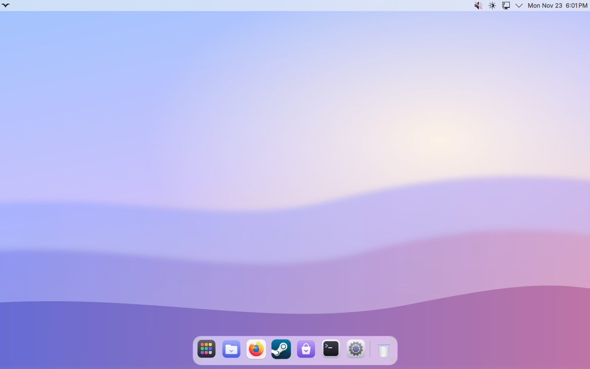

Why things are done the way they are is in [DECISIONS.md](DECISIONS.md). What still has to be
checked on real hardware is in [TESTING.md](TESTING.md).

## Status

| Area | Status |
|---|---|
| Build the ISO, install it in a VM, desktop starts | works, tested automatically on every build |
| Live USB stick: try it, then install | works in the VM, also with Secure Boot |
| Windows program through Wine | works, 64- and 32-bit, tested automatically |
| Secure Boot | works, tested automatically (full test) |
| Design (dock, top bar, windows, icons, lock screen) | round 4, still being refined |
| Real hardware (laptop, Rocket League online) | still open, see [TESTING.md](TESTING.md) |
| Updates over the internet | still open (D11) |

## Screenshots

All screenshots are from the automatic and manual tests in a VM.

| | |
|---|---|
|  Light mode | 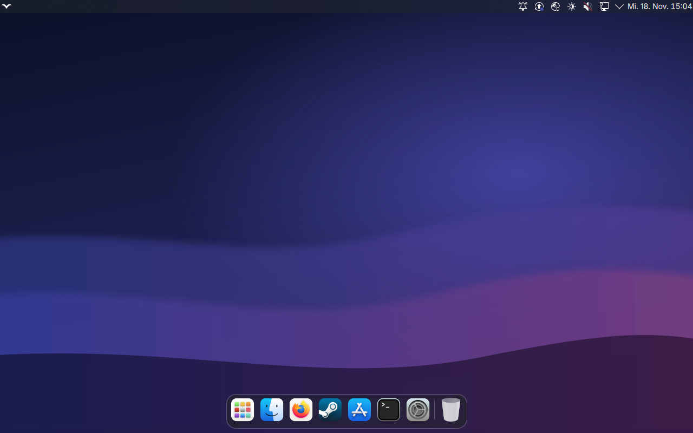 Dark mode ("Kestrel Dark") |
| 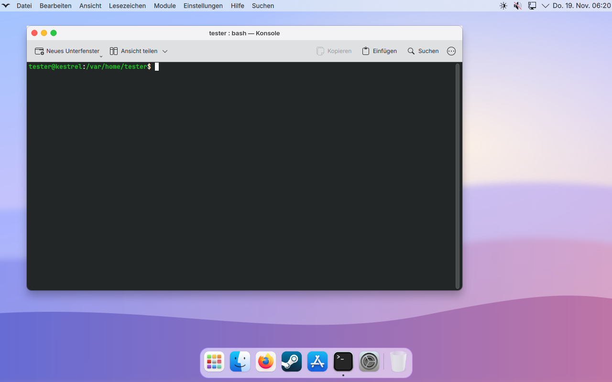 Window frame with real rounded corners: the window content is cut round too | |
| 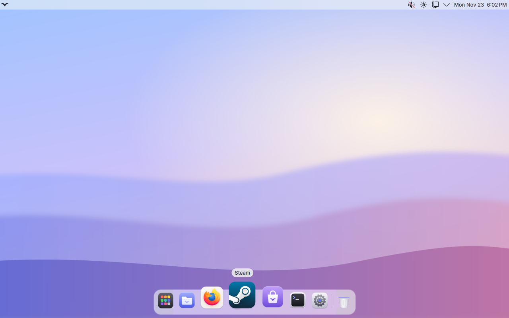 Dock with magnification and labels | 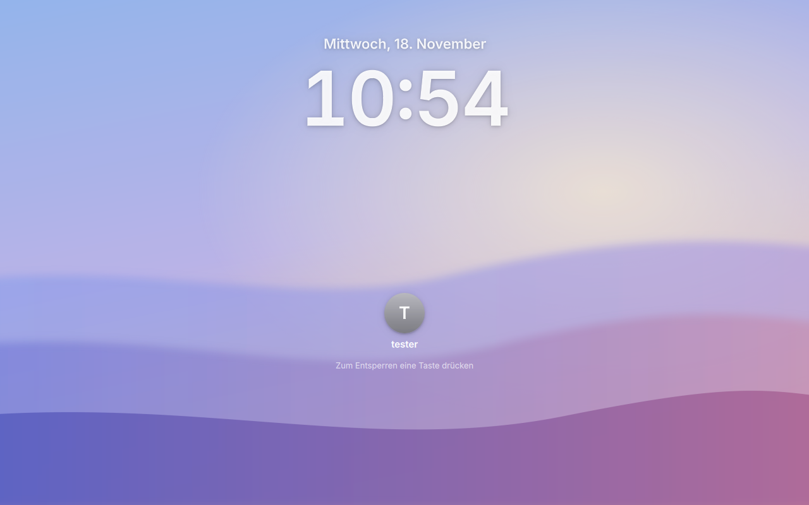 Lock screen |
| 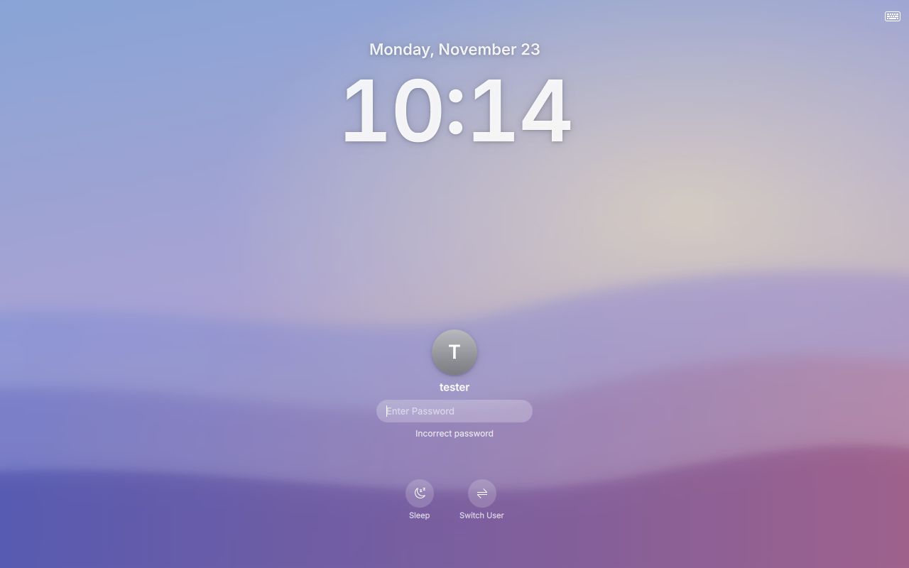 Lock screen after a wrong password | 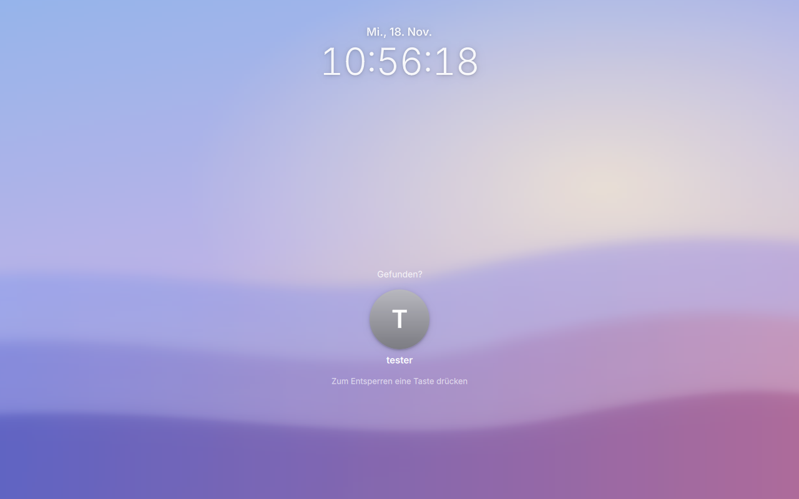 One of many lock screen styles: small thin clock, blurred wallpaper, a message |
| 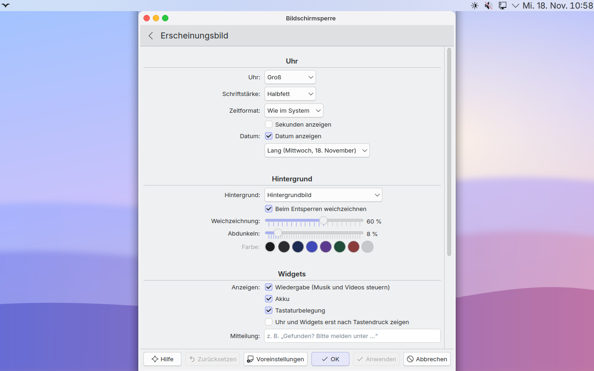 Lock screen settings | 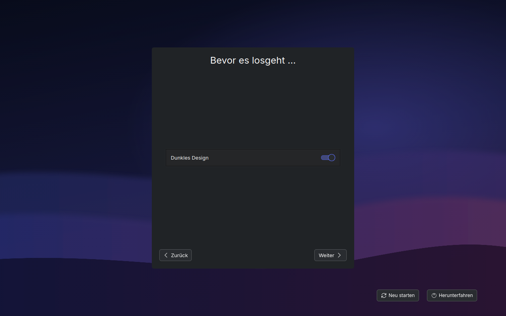 First-start setup with dark mode switched on |
| 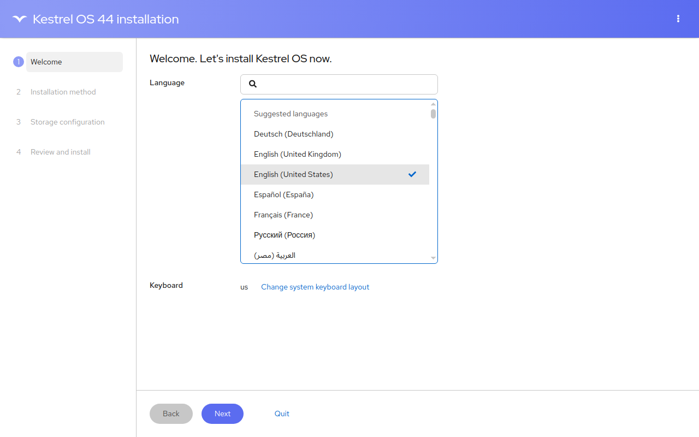 Installer from the live USB stick | 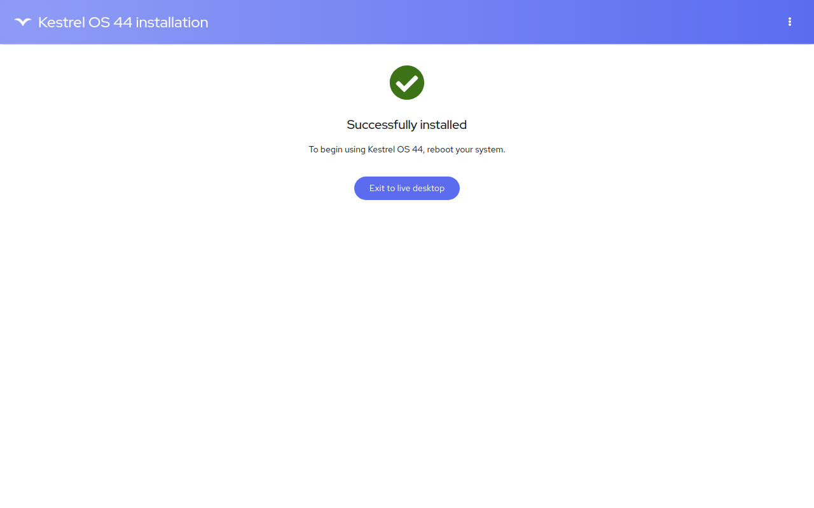 Installation finished |
| 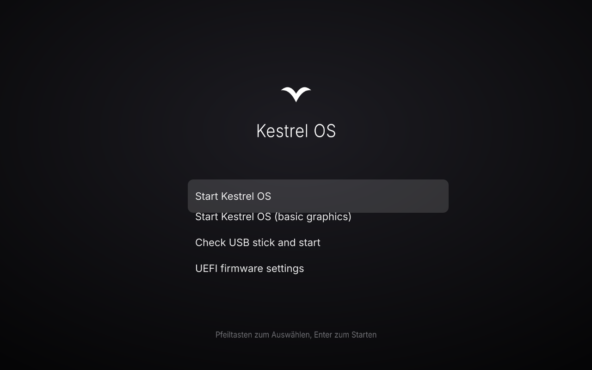 Boot menu of the live USB stick (same with Secure Boot) |  Boot screen |
| 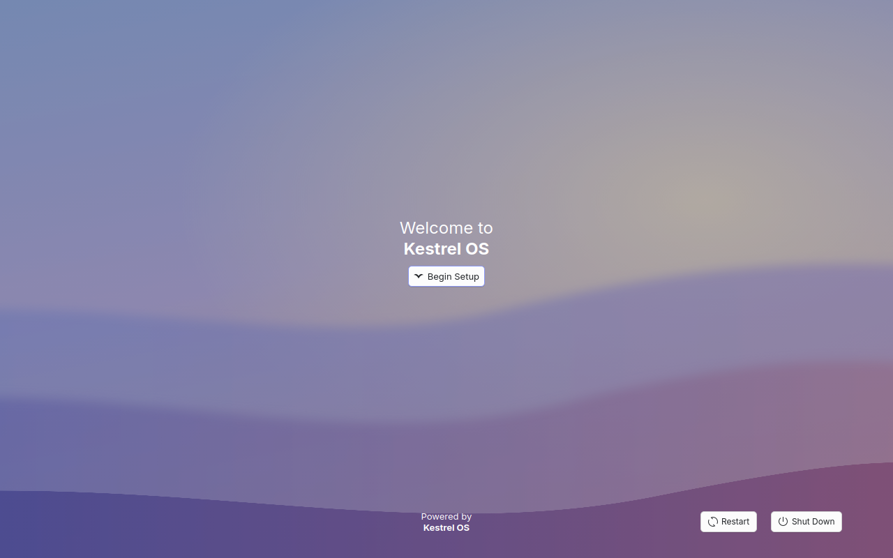 First-start setup | 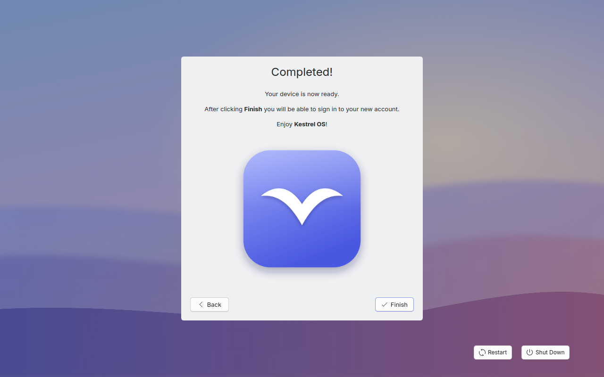 End of the setup |
| 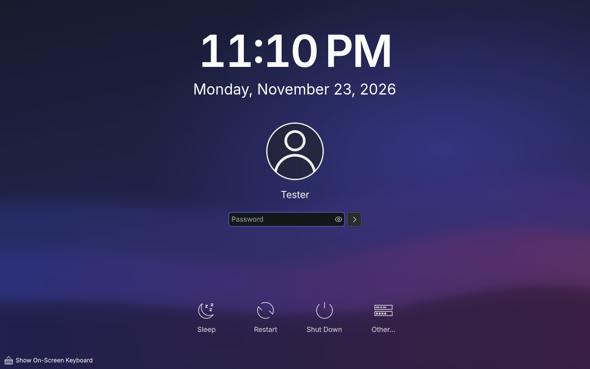 Login screen |  Start screen after logging in, fades into the desktop |

The system language in the screenshots is German; every language Fedora supports works.

## What's inside

**A desktop like the Mac**
- Dock at the bottom (frosted glass, magnifies under the mouse, small line under running
  apps), slim translucent top bar
- Traffic-light window buttons top left, soft shadows, real rounded window corners (own window frame)
- Kestrel's own icon set (close to WhiteSur, which stays selectable), Inter font
- Spotlight-like search with **Meta+Space**, Launchpad button in the dock
- Touchpad swipe gestures, light and dark mode ("Kestrel" and "Kestrel Dark", also automatic)
- Dock settings in System Settings (size, magnification, when it hides); a clock that is as big as the menus; sensible scaling on 4K TVs and monitors
- A clean terminal design, light and dark with the system; Windows programs (.exe) open with Wine by double click
- Mac-style lock screen: large clock, round user picture, lots of settings and widgets
  (now playing, battery, keyboard layout, your own message)
- Kestrel boot screen, boot menu, login screen, setup wizard and installer

**Gaming**
- Steam, Wine, Proton, Heroic, Lutris, Bottles, ProtonUp-Qt
- GameMode, MangoHud (FPS overlay), Gamescope
- Rules for controllers (Xbox, PlayStation, Switch) are preinstalled
- Easy Anti-Cheat (e.g. Rocket League) should run through Proton. This is checked on real
  hardware. Secure Boot stays on; nothing interferes with anti-cheat checks.

**Hardware**
- Intel and AMD graphics work right away. Nvidia drivers are included and only switch on
  when an Nvidia card is found.
- Also runs in VMs (QEMU/KVM, VirtualBox, VMware).

**Updates that don't break things**
- Updates are prepared in the background and only become active at the next restart.
- The previous system is kept. If something goes wrong, one command brings it back.

## Using it in the terminal

```bash
kestrel update     # update system and apps (takes effect after a restart)
kestrel rollback   # go back to the previous system (takes effect after a restart)
kestrel status     # which version is running, which one is prepared
```

## Project layout

```
config.env              all versions, names and sources in one place
build.sh                builds the image and the ISO
image/Containerfile     the system as a container image
image/build/            build steps: install/ (packages, slow, cached),
                        configure/ (settings, fast)
image/packages/         package lists (one line = one package)
image/artwork/          wallpaper, dock design and other artwork as source code
image/decoration/       the Kestrel window frame (C++, built against the image's KDE libraries)
image/dock-settings/    System Settings > Dock (C++ and QML, built the same way)
image/system_files/     files copied into the system 1:1 (incl. dock widget and lock screen)
image/live/             live layer for the USB stick (live start, installer, Kestrel branding)
iso/live/               builds the live ISO and the Kestrel boot menu
iso/release.toml        settings for the plain installer ISO
test/vm-test.sh         automatic test: installs the ISO in a VM and checks everything
test/live-test.sh       starts the live ISO in a VM and takes pictures
test/vm-live.sh         try design changes quickly, without rebuilding
sandbox/setup.sh        sets up the build environment
sandbox/watchdog.sh     watchdog for long builds (reports hangs)
docs/screenshots/       the screenshots above
```

## Building

Building only happens in a sandbox, never on the real system: Fedora in WSL2 on Windows (or a
Linux VM).

**Once on Windows:** under "Turn Windows features on or off", switch on the
**Windows Hypervisor Platform** (for the test VM). Then in PowerShell as administrator, and
restart afterwards:

```powershell
wsl --install --no-distribution
wsl --install FedoraLinux-44
```

In `C:\Users\<you>\.wslconfig` (proven with 16 GB RAM; more memory without swap made WSL freeze):

```ini
[wsl2]
nestedVirtualization=true
memory=8GB
swap=16GB

[experimental]
autoMemoryReclaim=dropCache
```

**Then in Fedora (WSL):**

```bash
git clone https://github.com/NeedlessPage819/KestrelOS ~/kestrel && cd ~/kestrel
sudo sandbox/setup.sh
sudo ./build.sh iso            # live ISO (try it, then install) in out/, UEFI only
sudo ./build.sh installer-iso  # plain installer ISO, also boots on old BIOS computers
```

The first build takes a long time (about an hour, all packages are downloaded). After that the
packages come from the cache, and design changes are in the image within minutes.

**Testing:**

```bash
sudo ./build.sh test-iso      # ISO that installs itself without questions
test/vm-test.sh               # full test incl. Secure Boot (over an hour)
QUICK=1 test/vm-test.sh       # quick test for design rounds, without the Secure Boot start
test/live-test.sh             # start the live ISO: pictures of menu, desktop, installer, Secure Boot
```

Screenshots end up in `out/test/vm/`.

**Watchdog for long builds** (on the Windows side, in Git Bash): reports when WSL stops
answering, the build writes no output for a long time, or Windows runs out of memory.

```bash
sandbox/watchdog.sh <systemd-unit> <build-log> [minutes-without-output]
```

**Try design changes live** (reuses the VM from the last test):

```bash
test/vm-live.sh start         # start the installed test VM
test/vm-live.sh deco          # compile and apply the window frame (image/decoration/)
test/vm-live.sh plasma        # apply the dock and top bar design
test/vm-live.sh dock          # apply the Kestrel Dock widget
test/vm-live.sh lock          # apply the lock screen and lock (unlock unlocks again)
test/vm-live.sh lockopt K V   # change a lock screen setting
test/vm-live.sh shot name     # screenshot to out/test/vm/name.png
test/vm-live.sh stop
```

## Third-party parts

| Part | Source | License |
|---|---|---|
| Base system | Fedora Kinoite via Universal Blue (`ghcr.io/ublue-os/kinoite-main`) | various free licenses |
| Nvidia drivers | Universal Blue akmods, from Nvidia | proprietary (freely redistributable) |
| Steam | RPM Fusion | proprietary (freely redistributable) |
| Icons | [WhiteSur](https://github.com/vinceliuice/WhiteSur-icon-theme), pinned to one version | GPL-3.0 |
| Live ISO build steps | adapted from [Titanoboa](https://github.com/ublue-os/titanoboa) (Universal Blue) | Apache-2.0 |
| Lock screen | based on Plasma's lock screen (unlocking logic unchanged) | GPL-2.0-or-later |

The exact versions of each build are in `out/manifest.txt` and `out/packages.txt`.
